# The County: the sound

**No one has listened to any of this.** Every sound in the game is synthesized
in the browser, was written by an agent that cannot hear, and has been revised
by others that cannot hear. What follows is the evidence a sound designer would
take in place of ears: spectrograms that were looked at, measurements of the
faults ears catch, and comparison with published descriptions of the real
sounds. It shows where pitch, rhythm, spectrum and level match published
figures and where they do not, that the renders are free of clicks, clipping
and audible loops, that no cue is buried by its bed or by another cue, and
that the four seasons differ from each other by more than a season differs
from itself. It does not show that the sounds are pleasant, that a listener
would name the bird, the axe or the barrel, that the reward for a goal is one
anybody wants to hear twice, or that ten hours of it is restful. Those need a
person, and the listening sheet near the end is for that person: ten minutes,
with headphones.

Everything here is reproducible. The sound is checked in a browser, and
browsers do not run on the laptop this is developed on, so the tools go to the
Windows box through `tools/remote/pc2.sh`:

    tools/remote/pc2.sh <name> 'node tools/audio/render.ts out/sound' out/sound <a folder here>
    tools/remote/pc2.sh <name> 'node tools/audio/check.ts chromium firefox webkit'
    node tools/audio/sheet.ts <that folder>

The first writes the WAVs, pictures and tables; the second holds every render
to the limits below and exercises the live game; the third (plain node, a
second) puts the tables into this file between the marks left for them.
`npm test` covers what needs no browser: which cue answers which event, what
each season's bed is made of, and what work can be heard from where
(`tests/audio.test.ts`).

## What was done

1. **See it.** `tools/audio/render.ts` renders every case in
   `src/audio/dev/cases.ts` offline at the default volume: the beds, each voice
   alone, every cue, the changes between them, one-minute scenes played through
   the same frame loop and event director as the live game, and a stress case.
   Each becomes a 16-bit WAV and a picture: spectrogram on a log axis from
   40 Hz to 16 kHz, the average spectrum beside it, the waveform under it.
   Birds, frogs and crickets also get a linear close-up.
2. **Measure it.** `src/audio/dev/analyze.ts`, on every render:
   - *Loudness*: ITU-R BS.1770 K-weighting with the standard's 48 kHz
     coefficients, 400 ms blocks at 75% overlap, gates at -70 LUFS and 10 LU
     under the ungated mean. Integrated, loudest 400 ms, loudest 3 s. The meter
     is checked against a -6 dBFS 997 Hz stereo sine, which must read -6.0.
   - *True peak*: the largest value after 4x windowed-sinc oversampling.
   - *Clicks*: the second difference of the waveform, taken 1, 4, 16 and 64
     samples apart, against every other such value within 80 ms. Six times the
     fourth-largest neighbour counts as a click. The test is calibrated on each
     run by planting steps in clean renders (the figures are under "The
     instruments" below). Renders made of drops or sharp blows (rain, dry
     leaves, an axe, stones) are exempt: their ticks are the sound.
   - *DC offset*; share of energy under 80 Hz, from 2 to 5 kHz, over 8 kHz;
     left-right correlation.
   - *Repeats*: normalised autocorrelation of the waveform (a noise loop
     coming round) and of the level in 20 ms steps (a pattern of events coming
     round), at lags from 1 s to half the render, as the height of the strongest
     peak over the 99.5th percentile of the rest.
   - *Cues*: 10 to 90% rise, time from peak to the last moment within 20 dB,
     and masking: the cue's loudest 170 ms against the bed's mean level in each
     third-octave band from 50 Hz to 12.5 kHz, reported for the band where the
     cue stands clearest, for the clearest band at 500 Hz or above (what a phone
     speaker plays), and against the loudest bed in the game.
   - *Cue against cue*: each cue's spectrum at its loudest and its rhythm (its
     level in 20 ms steps over two seconds) against every other cue's, to find
     pairs that could be taken for each other; and each moment that must not be
     missed against every short cue that can sound over it.
   - *Season against season*: a print of each of the four season beds (where
     its energy lies by third-octave band, and how much each band comes and
     goes) against the other three, and against the same season rendered again
     with different luck.
   - *Features for comparison*: note onsets, lengths and pitches of each bird
     and frog; pulse and chirp timing of a cricket; spectral lines and octave
     bands of the engines; onset times and levels of each knock and blow.
3. **Compare it** with published descriptions of the real sounds (below).
4. **Fix it.** Rounds 1 to 8 were the first rebuild: round 1 is the sound as it
   first shipped; round 2 rebuilt the noise, the stereo, the tractor, the barrel
   and the closes, and turned the loudness the right way up; round 3 matched
   the birds, crickets, wind, rain and tractor to the references; round 4 made
   every fade even to the ear and gave each layer noise of its own; round 5 put
   the birds in bouts and slowed the weather's crossfades; round 6 took out the
   compressor (see "One soundscape"); rounds 7 and 8 re-centred levels. Rounds
   9 onward are the farmstead: cues for people, land, buildings and paper, work
   that can be heard, picks, and the seasons (see "The farmstead rounds").

The limits are in `src/audio/dev/plan.ts`. They are choices, not standards,
except where a standard is named.

## The loudness plan

All figures are LUFS at the default volume setting (0.6, a gain of 0.54). The
slider's top is 8.9 dB above that.

| Layer | Target | Why |
| --- | --- | --- |
| Title, plan, ledger | -48 to -35 integrated | A breeze, the brook and a bird now and then. |
| Cellar and deep winter | -50 to -40 | Close to silence. |
| Fair-weather beds, the four seasons | -45 to -33 | A breeze, with birds, frogs, crickets or geese. |
| Tractor working, alone | -41 to -33 | Hours of it must be ignorable. |
| The truck hauling, picked | -44 to -34 | Under the tractor. |
| Rain | light -45 to -36, heavy -35 to -28, storm -32 to -25 | |
| Gale | -32 to -26 | |
| Loudest bed (storm, gale, tractor) | -29 to -22 | Nothing continuous goes above this. |
| One bird's song | -38 to -27, loudest 400 ms | Under the cues. |
| Work, picked (felling, building, brush, rocks, barrels) | -46 to -29 integrated, by kind | Present, and under a working tractor's bed with the cue that crowns it still to come. |
| Work, going on somewhere | -56 to -41 | Quiet by default: 10 dB down and dulled, as if across the farm. |
| A pick (field, tract, person, yard) | -42 to -31, loudest 400 ms | Heard many times a minute: barely there. |
| The order knock | -38 to -27 | Answers every order. |
| Routine cues: planted, hilled, sprayed, watered, sold, rocks, brush, a paper signed, a building begun, a matter closed | -31 to -24 | About 10 LU over a fair bed. |
| Notable cues: a tract felled, stumps out, tile in, logs sold, a building up, hired, gone, a level gained, the people's bar, a breakdown and its repair, land bought | -29 to -22 | |
| Warnings | -28 to -22 | Distinct, never the loudest thing. |
| Test dig, dig day | -28 to -21 | The key moments are the loudest cues. |
| The knock at the door, the weigh ticket, a goal met | -27 to -20 | The moments that must not be missed. |
| Year end -28 to -21, farm kept -26 to -20, farm lost -30 to -23 | | The loss is the quietest close. |
| A minute of play | -38 to -29 integrated (to -27 with work picked) | |
| True peak | under -6 dBTP at default, under 0.98 full scale at the slider's top | |

For scale: EBU R 128 sets programme loudness at -23 LUFS and Sony's ASWG-R001
sets games at -24 (home) and -18 (portable). A minute of this game at the
default volume measures about 10 LU under a television programme, and at the
slider's top about level with one. That is what "modest" means here. Speech is
kept 10 to 15 LU over its bed in broadcast practice (Torcoli et al. 2019); the
job cues sit about 10 LU over a fair-weather bed. ISO 7731 calls a signal
clearly audible at 13 dB over the masking noise in a third-octave band, and
every cue is held to that against the bed it plays over. Warnings, the two dig
cues, the knock, the weigh ticket and the goal must also stand 3 dB clear of
the loudest bed and 6 dB clear of their own bed at 500 Hz and above.

Other limits: no click; DC under -60 dBFS; no repeat standing more than 0.2
(waveform) or 0.35 (rhythm) above the rest of the autocorrelation; in a bed,
no more than 30% of the energy under 80 Hz, 45% between 2 and 5 kHz (birds,
frogs and crickets excepted: that band is where they live) and 10% over 8 kHz;
left and right never out of phase; a cue fully decayed before its render ends;
any two of the four seasons at least 6 dB apart in their prints and at least
twice as far apart as a season is from itself on another day; no two cues of
different families within 6 dB of each other in spectrum with rhythms more
than 0.85 alike; and each moment that must not be missed at least 6 dB clear,
in some band, of any short cue that can sound over it.

No published limit was found for the share of energy between 2 and 5 kHz that
a listener tolerates for half an hour. The limit here leans on the ear's
sensitivity peaking near 3 kHz (ISO 226) and sharpness weighting rising from
3 kHz (DIN 45692). It is a guard, not a finding. The limits on seasons and on
cue against cue are of the same kind: made for this check, with no standard
behind them.

## Nothing more often than it means

A ten-hour game cannot have a sound that fires as often as the simulation
does. Each cue has a least gap (the table below), and the director
(`src/audio/director.ts`) adds three rules:

- At the fastest clock six days go by in a second: a job is heard once a
  second, not once a field; a warning once in 2.5 s, and of several on one day
  only the gravest; the people's iron bar once in 4 s.
- The longer cues take turns. When a day brings a weigh ticket, a knock at the
  door and a tree down, they sound one after another, the most pressing first,
  each beginning over the tail of the one before. A cue that would come more
  than 7 s late (10 s for the three that must not be missed) is dropped.
- A goal's reward waits for everything else, a close included, and then has
  the air to itself. When the farm is kept or lost the close is the reward and
  no goal sounds over it.

Work is quiet by default: 10 dB down and low-passed at 1.8 kHz while it is only
going on somewhere, at full level only when the player has picked the person
doing it or the place it is done, silent when the clock is stopped, on a
Sunday the farm keeps, and when the weather stops the work. Reduced motion
changes nothing here: the setting is for the eye.

## Final measurements

Chromium, at the default volume, from the last full run of
`tools/audio/render.ts`. Rows from `bed: title screen` to `stress` are every
case in `src/audio/dev/cases.ts`.

<!-- table:start -->
<!-- table:end -->

### The instruments

What the run said of its own tools: the smallest planted step the click test
finds in three kinds of sound, what a gale costs to render, and the loudness
meter against a known tone.

<!-- instruments:start -->
<!-- instruments:end -->

The peak with the slider at its top, and the level on the bus before the
master chain, are worked out from the render at the default volume: the chain
is a gain and a ceiling applied sample by sample, with no memory, so while a
render stays under the ceiling's knee (0.7 of full scale) both follow from it
exactly. A render that reaches the knee is made again at the top volume and
without the chain. Only the stress case does.

### The first rebuild, before and after

Before and after (round 1 against round 8; loudness is integrated for beds
and voices, loudest 400 ms for cues):

| render | LUFS before | after | loop before | after | under 80 Hz % before | after | L/R before | after |
| --- | ---: | ---: | ---: | ---: | ---: | ---: | ---: | ---: |
| bed: title screen | -31.3 | -38.5 int | 0.64 | 0.04 | 2 | 0 | 0.17 | 0.69 |
| bed: spring plan | -32.3 | -41.1 int | 0.76 | 0.04 | 2 | 0 | 0.04 | 0.57 |
| bed: June, fair | -28.0 | -37.9 int | 0.60 | 0.03 | 2 | 0 | 0.09 | 0.48 |
| bed: June, fair, tractor working | -27.0 | -34.2 int | 0.07 | 0.04 | 34 | 17 | 0.46 | 0.80 |
| bed: August, steady rain, 9 mm | -25.6 | -35.0 int | 0.58 | 0.01 | 2 | 0 | 0.01 | 0.12 |
| bed: August, drizzle, tractor working | -28.7 | -35.2 int | 0.09 | 0.08 | 42 | 20 | 0.54 | 0.86 |
| bed: August, fair and warm, crickets | -31.7 | -42.2 int | 0.52 | 0.03 | 2 | 0 | 0.11 | 0.51 |
| bed: late September, fair | -23.7 | -35.5 int | 0.89 | 0.01 | 2 | 0 | 0.01 | 0.22 |
| bed: late September, digging | -23.6 | -33.2 int | 0.43 | 0.07 | 18 | 14 | 0.21 | 0.64 |
| bed: October gale, 11 m/s | -18.4 | -28.0 int | 0.56 | 0.01 | 2 | 0 | 0.01 | 0.21 |
| bed: storm, 45 mm, tractor working (the loudest bed) | -16.2 | -24.3 int | 0.54 | 0.02 | 6 | 3 | 0.06 | 0.24 |
| bed: cellar, November | -35.0 | -45.3 int | 0.47 | 0.01 | 1 | 0 | 0.00 | 0.21 |
| bed: cellar, January | -33.5 | -43.1 int | 0.51 | 0.01 | 2 | 0 | 0.01 | 0.21 |
| bed: ledger and year end | -31.8 | -38.5 int | 0.67 | 0.14 | 2 | 0 | 0.13 | 0.49 |
| wind: breeze, 3.2 m/s, 90 s | -29.4 | -42.6 int | 0.60 | 0.01 | 2 | 0 | 0.01 | 0.21 |
| wind: gale, 11 m/s, October | -18.4 | -28.0 int | 0.56 | 0.01 | 2 | 0 | 0.01 | 0.21 |
| wind: the spruce ridge alone, 3.2 m/s | - | -43.5 int | - | 0.01 | - | 0 | - | 0.21 |
| wind: the spruce ridge alone, 7.5 m/s and over | - | -29.6 int | - | 0.00 | - | 0 | - | 0.22 |
| wind: cold whistle alone | -36.7 | -48.6 int | 0.32 | 0.02 | 0 | 0 | -0.01 | 0.22 |
| rain: light, 3 mm | -38.3 | -40.6 int | 0.78 | 0.00 | 0 | 0 | -0.00 | 0.01 |
| rain: heavy, 18 mm | -23.7 | -32.0 int | 0.85 | 0.01 | 1 | 0 | 0.00 | -0.00 |
| rain: storm, 45 mm | -19.6 | -29.1 int | 0.93 | 0.01 | 2 | 0 | 0.00 | -0.00 |
| birds: May morning, 60 s | -26.1 | -35.3 int | 0.13 | 0.07 | 0 | 0 | 0.95 | 0.63 |
| bird: white-throated sparrow, rising form | -26.2 | -32.7 int | - | - | 0 | 0 | 0.99 | 0.99 |
| bird: white-throated sparrow, falling form | - | -32.3 int | - | - | - | 0 | - | 1.00 |
| bird: black-capped chickadee | -26.9 | -34.1 int | - | - | 0 | 0 | 0.99 | 0.99 |
| bird: American robin, one group of phrases | -30.0 | -37.2 int | - | - | 0 | 0 | 0.98 | 0.99 |
| bird: dark-eyed junco | -34.6 | -36.6 int | - | - | 0 | 0 | 0.99 | 1.00 |
| crickets: August, 20 C | -36.7 | -43.2 int | 0.11 | 0.04 | 0 | 0 | 0.69 | 0.93 |
| crickets: one cricket, 20 C | -42.3 | -44.9 int | 0.22 | 0.11 | 0 | 0 | 1.00 | 1.00 |
| tractor: working | -35.1 | -37.2 int | 0.09 | 0.05 | 78 | 24 | 1.00 | 1.00 |
| tractor: idling (work on foot) | -44.3 | -40.5 int | 0.17 | 0.10 | 84 | 24 | 1.00 | 1.00 |
| cue: planted | -32.6 | -26.0 mom | - | - | 0 | 0 | 1.00 | 1.00 |
| cue: hilled | -35.9 | -27.7 mom | - | - | 0 | 0 | 1.00 | 1.00 |
| cue: sprayed | -32.4 | -26.1 mom | - | - | 0 | 0 | 1.00 | 1.00 |
| cue: watered | -36.6 | -27.9 mom | - | - | 0 | 0 | 0.98 | 0.99 |
| cue: test dig (6 tubers on the tray) | -28.3 | -25.8 mom | - | - | 0 | 0 | 1.00 | 1.00 |
| cue: dug (a basket into the barrel) | -28.3 | -23.2 mom | - | - | 0 | 3 | 1.00 | 1.00 |
| cue: sold | -32.3 | -26.0 mom | - | - | 0 | 0 | 1.00 | 0.99 |
| cue: warning, frost (C4) | -25.0 | -23.7 mom | - | - | 0 | 0 | 0.97 | 0.97 |
| cue: warning, blight watch (A3) | -25.9 | -24.4 mom | - | - | 0 | 0 | 0.98 | 0.98 |
| cue: warning, blight seen (G3) | -24.9 | -23.6 mom | - | - | 0 | 0 | 0.98 | 0.98 |
| cue: warning, dry (E3) | -25.5 | -24.1 mom | - | - | 0 | 0 | 1.00 | 0.99 |
| cue: warning, a field lost (D3) | -25.7 | -24.3 mom | - | - | 0 | 0 | 0.98 | 0.98 |
| cue: year-end ledger | -26.8 | -22.8 mom | - | - | 0 | 0 | 0.99 | 0.99 |
| cue: five seasons kept | -26.3 | -22.1 mom | - | - | 0 | 0 | 0.99 | 0.99 |
| cue: the farm lost | - | -24.9 mom | - | - | - | 18 | - | 0.99 |
| change: fair, then storm, then fair again | -18.2 | -30.2 int | - | - | 2 | 0 | 0.01 | 0.16 |
| change: tractor starts, works, idles, stops | -37.2 | -38.8 int | - | - | 80 | 23 | 1.00 | 1.00 |
| change: sound off and on again, tab hidden and shown | -28.4 | -35.3 int | - | - | 40 | 17 | 0.58 | 0.84 |
| change: title, plan, season, cellar, ledger with its close | -29.6 | -32.6 int | - | - | 2 | 0 | 0.10 | 0.91 |
| seam: every looped buffer wrapping round | -19.0 | -33.9 int | - | - | 8 | 6 | 0.10 | 0.34 |
| scene: fair June morning, the farmer planting | -27.7 | -34.9 int | 0.16 | 0.04 | 30 | 14 | 0.42 | 0.77 |
| scene: wet August day, blight warning, spraying | -27.1 | -34.0 int | 0.33 | 0.13 | 16 | 7 | 0.25 | 0.72 |
| scene: dig day in late September, then a sale | -24.4 | -32.4 int | 0.55 | 0.02 | 13 | 7 | 0.16 | 0.64 |
| stress: storm, gale, tractor and every cue at once | -15.7 | -18.0 int | - | - | 4 | 1 | 0.23 | 0.91 |

The before figures for masking are not shown: round 1 was measured with an
earlier version of the masking test that counted bands where the cue was
barely present. Round 1's cues were also rendered a tenth of a second into a
fresh context, while the compressor then in the chain was still opening, and
read about 1 dB low.

What the first round's numbers showed, in the designer's terms:

- **The beds were louder than the cues.** A fair June bed sat at -28 LUFS and
  an October gale at -18, while the planted cue's loudest moment was about
  -32. The plan is now the other way up.
- **Every noise bed was a 5-second loop** (repeat 0.5 to 0.9 at 5.0 s), and
  light rain a 6-second one. Listeners pick out repeated noise up to cycles
  of 10 to 20 s (Kaernbach 2004). Noise now comes from three passes over a
  32-second buffer at speeds that wander by 1%, so no pass lines up with the
  last; the strongest repeat left anywhere is 0.14.
- **Wind and rain leaned left.** They were made stereo by delaying the right
  channel 11 to 31 ms, which the ear hears as a source on the left with an
  echo on the right, and which combs when summed to mono. They are now a
  middle and a side made from separate noise.
- **The tractor was a 14.5 Hz buzz** with 78% of its energy under 80 Hz,
  where a laptop plays nothing.
- **The tubers were a drum**: one resonance near 200 Hz, a bright click on
  top, evenly spaced.

## The four seasons, with the eyes shut

The bed used to follow the weather and, for birds and crickets, the month. It
now follows the calendar as well (`src/audio/scene.ts`), and each of the four
seasons has voices the other three do not:

| | Spring (late April to June) | High summer (July, August) | Harvest (mid September to the freeze) | Deep winter (the cellar months) |
| --- | --- | --- | --- | --- |
| Its own | Peepers along the brook; the brook in flood; the full run of birdsong | Field crickets; a bumblebee going by in the blossom; wind in full leaf | Geese going over; crows on the dug ground; dry leaves blowing and rattling; a thin cold edge to the wind | A thin cold wind; a tree cracking in the frost; nothing running |
| Shared with | Wind | Wind, a low brook | Wind, the chickadee's call, a low brook | The chickadee's call, a crow now and then |
| Never there | Crickets, bees, geese, dry leaves | Birdsong, peepers, geese | Peepers, crickets, song | Water, insects, frogs, geese, rain |

The voices come in and go out over two or three weeks, not at the turn of a
month, and they still answer the weather: peepers call hardest on a mild wet
day and least under a bright sky, bees fly only on a fair warm one, geese and
crows keep down in a storm, wet leaves do not rattle.

The check renders one fair day of each (a minute each: May 20, August 5,
October 5, and January in the cellar) and takes a print of it: its level in
each third-octave band under its own strongest band, and how much each band
comes and goes from one 170 ms frame to the next. Two prints are compared by
the root-mean-square difference across the bands. Every pair of seasons must
be at least 6 dB apart and at least twice as far apart as a season is from
itself rendered again with different luck (other birds, other gusts):

<!-- compared:start -->
<!-- compared:end -->

The second table there is a different question: each moment that must not be
missed, sounding at the same instant as each short cue that can sound over it
(the longer ones take turns), and how far it still stands clear in the band
where it stands clearest.

## The cues

Every cue the director can sound (`CUES` in `src/audio/director.ts`), made by
`tools/audio/render.ts` and put here by `tools/audio/sheet.ts`:

<!-- cues:start -->
<!-- cues:end -->

Three families share a sound on purpose, so that the family is learned once.
The warning chime is one struck note at five pitches, lower for worse. The
people's iron bar is the same: once and high for someone worn out, once and
lower for someone unhappy, twice and lower still for someone hurt. Paper is a
pen: alone for a contract, a lease, a raise or a contractor ordered; with a
stamp for land bought; with the stamp and coins when the mortgage is paid.
Coins also close the sale of logs, so money sounds like money wherever it
comes from.

## Each sound and what it was matched to

Numbers under "render" were measured from the final WAVs, not read from the
code, except ranges given "by bird" or "by cricket" and figures marked "as
written", which are the code's. Note lengths are taken within 14 dB of each
song's peak. Sources are listed at the end; the notes there say which were
read first hand and which through research agents.

### White-throated sparrow

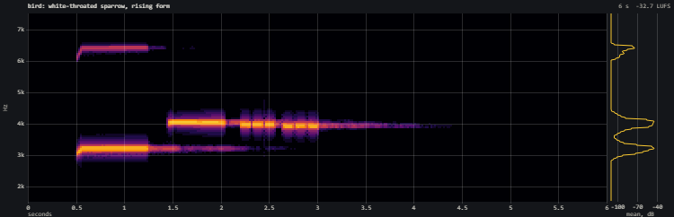

| | Published | Render |
| --- | --- | --- |
| Tone | Clear whistles, steady in pitch, nearly pure (Borror and Gunn 1965; Riede and Suthers 2009) | Sine with a second harmonic at -30 dB; each note within 0.5% of its pitch |
| Lowest whistle | 3206 Hz mean in Maine, range 2600 to 3900 | 2800 to 3700 Hz by bird; this one 3203 |
| Step between the long whistles | Ratio 1.26 (Grunst et al. 2018); Maine mean 2.6 semitones, range 0.4 to 6.6 | 1.6 to 5.2 semitones by bird; this one 4015 / 3203 = 1.25 |
| First whistle | 0.68 s mean, 0.27 to 1.17; about half of songs scoop up into a note | 0.73 s here (0.72 s give or take 7%); half the birds scoop the first from 6% under, this one from 3057 Hz |
| Second whistle, gaps | 0.52 to 0.62 s; gaps 0.17 to 0.20 s (Weary and Weisman 1992) | 0.58 s; gaps 0.22 and 0.17 s |
| Triplet | 0.39 s mean (0.24 to 0.63), three equal parts split by breaks of 0.02 s or less | Parts 93 to 95 ms, starting 125 ms apart, 0.34 s in all |
| Triplets in a song | Mean 1.8, Maine 1.4, range 0 to 7; pitch sinks half a semitone through them | 1 to 3, the last sometimes dropped; 3966 then 3918 Hz |
| Whole song | 2.87 s mean | 2.5 s (rising), 3.1 s (falling, with a third whistle) |
| Form | Maine in the 1960s: 82% rising, 2% falling; New York in 2018: 46% and 44% | 80% of birds rising |
| Between songs | 5 to 10 s; one pattern and one pitch per male | 5 to 10 s; a bird keeps its song |

The song that shipped had its whistles 0.6 and 0.5 s long with an 80 ms gap,
and every triplet note slid down by the same 60 Hz. Still different: the
two-note ending that has spread from the west is left out (148 of 150 recent
songs from Quebec and the Maritimes still end in triplets); real notes wander
more within themselves than these do.

### Black-capped chickadee

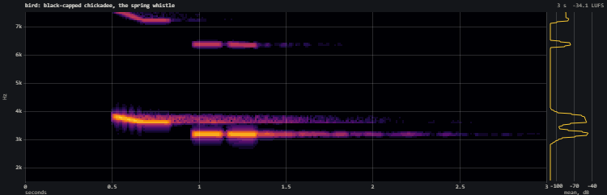

| | Published (Weisman et al. 1990, 132 birds; Ficken et al. 1978) | Render |
| --- | --- | --- |
| Fee | 3814 Hz falling to 3609 over its first 184 ms (ratio 1.056) | 3784 to 3603 Hz (1.050) |
| Bee | 3183 Hz; fee end to bee 1.134 | 3177 Hz; 1.134 |
| Lengths | Fee 0.34 s, gap 0.135 s, bee 0.37 s | 0.31, 0.15, 0.35 s |
| Bee | A dip or a 0.05 s break near the middle, in every bird | Two halves of 151 ms with a 51 ms break |

It shipped with a fee that fell 30 Hz, not 200, and a wobble in pitch where
the bee should dip in loudness. Still different: a real male shifts his whole
song by about 330 Hz every 30 or 40 songs; a bird here sings three to five and
goes quiet. Chickadees whistle little after morning, so it is the rarest of
the four.

### American robin

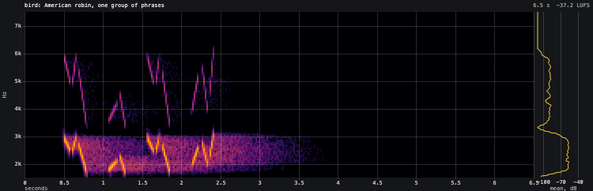

| | Published (Johnson 2006; Bent 1949) | Render |
| --- | --- | --- |
| Range | 1.5 to 4 kHz | 1.74 to 2.96 kHz in this group; 1.65 to 3.9 allowed |
| Phrase | 150 to 350 ms; 1 to 4 notes, usually 2 or 3, each sliding 300 to 1500 Hz | 2 or 3 notes of 35 to 99 ms sliding 290 to 870 Hz |
| Pace | About two phrases a second | Phrases start 0.57, 0.49, 0.57 s apart |
| Grouping | Groups of 2 to 5 phrases, about a second between groups | Groups of 3 to 7, 0.8 to 1.5 s between; a bird sings 2 to 4 groups |
| Repertoire | About 10 phrase types a male, sung in favoured orders, alternating up and down | 8 to 13 types a bird, alternating rising and falling |

It shipped as four identical up-and-down sweeps. Still different: the slides
are straight lines where a robin's curve; the high, thin "hisselly" phrases of
the dawn song are left out.

### Dark-eyed junco

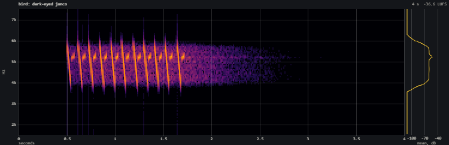

The trill that shipped was "like a chipping sparrow or junco": 10 to 16 chips
at 15 a second, lasting about a second. The junco is the bird of the spruce
edge and is the one modelled now.

| | Published (Titus 1998; Konishi 1964; AAB) | Render |
| --- | --- | --- |
| Trill | 1.5 s (1.2 to 1.6); 9 to 21 notes; about 9 a second, 13.6 in a Newfoundland bird | 1.20 s; 11 notes; 8.8 a second (8.5 to 13.5 by bird) |
| Note | 80 ms with a 36 to 40 ms gap; most notes have more than one part | About 65 ms and 48 ms; a falling part of 35 ms and a shorter one above it |
| Range | 3.4 to 6.5 kHz | 5.6 down to 4.1 kHz, then a note at 5.2 (written to span 3.7 to 5.9) |

### Field crickets

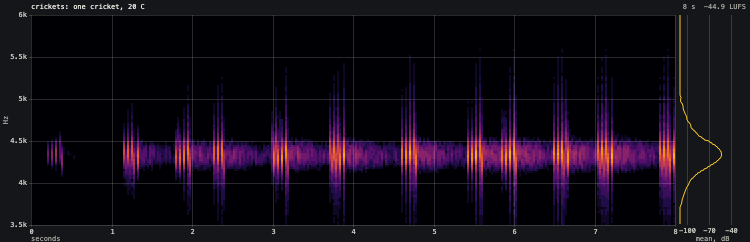

The code that shipped used Dolbear's law. That law was measured on the snowy
tree cricket, which keeps strict time, sings near 3 kHz, and does not live as
far north as potato country (no record north of 44.7 N). The cricket of a
northern potato field in August is the fall field cricket, *Gryllus
pennsylvanicus*.

| | Published | Render, one cricket at 20 C |
| --- | --- | --- |
| Carrier | 4.16 to 5.11 kHz between males, mean 4.65 to 4.7 (Bertram et al. 2013; Harrison et al. 2013; SINA) | 4350 to 5000 Hz by cricket; this one 4349 |
| Within a pulse | Falls about 215 Hz (measured on the SINA recording) | Falls 4.6% |
| Pulses in a chirp | 3 to 5, usually 4 | 3 2 4 4 4 4 4 4 4 4 |
| Pulse spacing | 41, 46, 52 ms through a chirp at 24.4 C; 34 to 42 ms at 29 C | 53 ms mean at 20 C, each gap longer than the last |
| Pulse length | 18.4 ms, 14.6 to 22.4 | 0.41 of the spacing: 22 ms at 20 C |
| Swell | -7.3, -2.4, -0.5, -0.1 dB through a four-pulse chirp | The same |
| Chirp rate | 1.25 a second at 24.4 C (SINA); 2 to 3 in field accounts; 2.5 to 4 at 29 C (Alexander 1957) | 1.4 a second at 20 C on average, each cricket 0.65 to 1.35 of that; this one 1.51 |
| Regularity | "An irregular chirper"; gaps vary by 21% | Gaps vary by 22% |
| Together | No synchrony reported | Each keeps its own pace |

Temperature: chirp rate goes as (T - 6 C) and pulse rate as (T + 6 C), the
shape measured in *G. firmus* (Pires and Hoy 1992), anchored at 1.9 chirps a
second at 25 C and 46 ms at 24.4 C. No such curve was found for
*G. pennsylvanicus* itself. They are silent under about 12 C. Still
different: four crickets, where a field has hundreds; no difference between
day and night.

### Rain

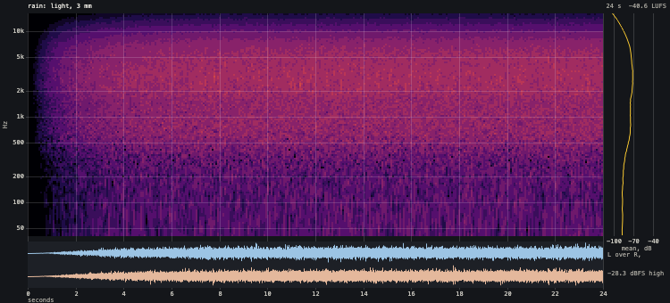
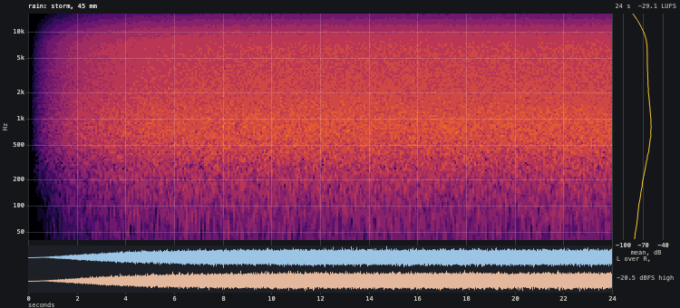

No calibrated spectrum of rain heard in air was found, so this is matched to
descriptions. Rain raises the level across the spectrum, most between 0.6 and
1.2 kHz and between 4.4 and 5.6 kHz where drops strike leaves (Metcalf et al.
2020; Bedoya et al. 2017); in light rain single drops are heard, and as it
gets heavy they run together into steady noise (Brown et al. 2018); heavy
rain lifts the 0.6 to 1.2 kHz band by 8 to 21 dB in three forest recordings
and hardly at all on a city balcony (read off the hardRain paper's figure).

In the render, light rain is separate ticks (a few cycles each, centred on
3.6 kHz and spread an octave either way) over a faint hiss from 0.6 to
6.5 kHz. As rain gets heavy the hiss grows and opens to 8 kHz, and a band
around 850 Hz comes up under it. Measured, the 0.6 to 1.2 kHz band rises 12 dB
from light rain to heavy and 17 dB to a storm; the 4.4 to 5.6 kHz band rises
8 and 10 dB.

What shipped was a 6-second loop of ticks with a hard upper edge at 5.6 kHz,
and for heavy rain a rumble under 160 Hz that rain does not make. Still
different: no drip from a roof, no thunder; the ring of drops on standing
water is a guess at 3 to 7 kHz from one paper on a dripping tap.

### Wind

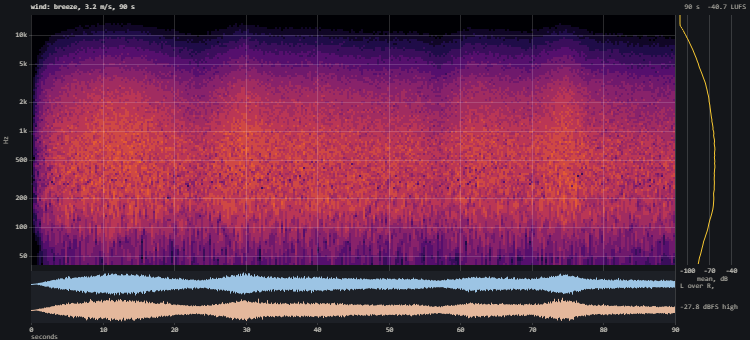
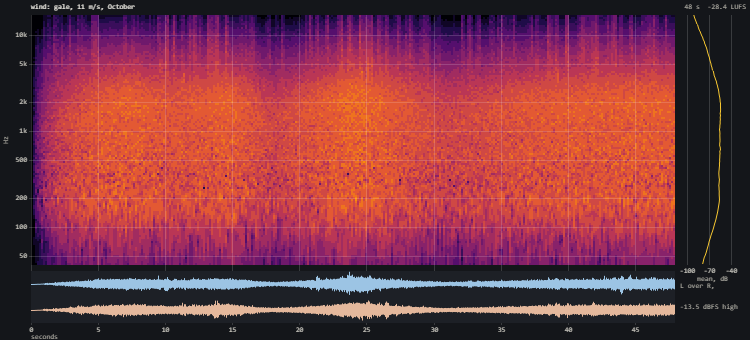

| | Published (Bolin 2009; Fegeant 2002; Boersma 1997) | Render |
| --- | --- | --- |
| Conifers | A band peaking at 0.2 x wind speed / needle thickness: 200 Hz per m/s for spruce, about an octave and a half wide | Band-pass of that width centred on 200 Hz x speed. The ridge alone peaks at 697 Hz at 3.2 m/s (3 dB down at 404 and 1195) and at 1693 Hz at 7.5 m/s and over (996 and 2648); gusts, which are louder and higher, pull both above the plain 640 and 1500 |
| Leaves | Rustle around 4 kHz from leaves touching | Band from 2.6 to 5.2 kHz, mostly in gusts |
| Level against speed | 9 to 12 dB for each doubling | 14.6 dB from 3.2 m/s to 7.5 m/s and over (1.2 doublings: 11 to 15 dB by the published slopes) |
| Gusts | Level wanders 2.3 to 5.2 dB (standard deviation) on a scale of about 10 s | 2.8 dB in a breeze and 2.7 dB in a gale, second by second; a new gust every 3 to 9 s |

Under those two sits a broad low rush, the air itself over open ground, and in
cold months a thin pitched whistle of wind at a gap. Neither has a reference;
they are a designer's layers. What shipped was low-passed noise with most of
its energy between 70 and 500 Hz, at -18 LUFS in a gale.

### Tractor

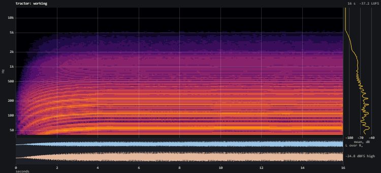
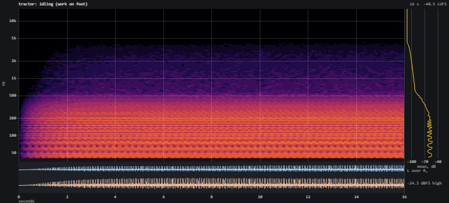

The tractor in the scene is small and red, and the Farmall H is the model
here: four
cylinders, four-stroke, 152 cubic inches, governed at 1650 rpm (Nebraska Test
333), low idle about 450. A four-stroke four fires twice a turn: 55 Hz at
work, 15 a second at idle.

| | Reference | Render |
| --- | --- | --- |
| Firing, at work | 55 Hz and its multiples | Lines at 54.8, 109.9, 164.9, 219.8 Hz |
| Between them | Half orders from uneven cylinders, weaker; no published level | 41.1, 68.6, 96.1 Hz and so on, 11 to 12 dB under |
| Idle | 13 to 15 firings a second, heard as a putter, not a pitch | Lines every 15.0 Hz |
| Speed under load | Governor holds within 4% | Wanders within 2%, as written |
| Octave bands from 63 Hz to 4 kHz, dB against the 125 Hz band, open exhaust (Bies and Hansen, in Guyer) | -6, 0, -4, -12, -16, -22, -32 | -2.8, 0, -2.5, -12.8, -15.5, -20.6, -32.7 |

What shipped fired at 29 Hz, which is this engine's crank speed and half its
firing rate, with its strongest line at 14.5 Hz, and was low-passed at 230 Hz.
Still different: no starter, no gear whine, no change with distance as it
crosses the field beyond a slow drift from side to side. The level of the half
orders is a guess.

### Tubers on wood: the test dig and dig day

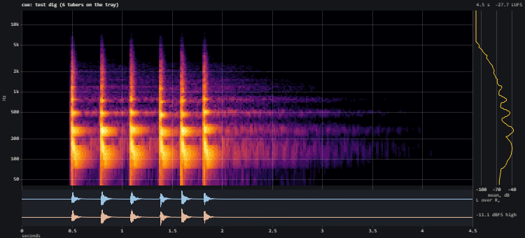
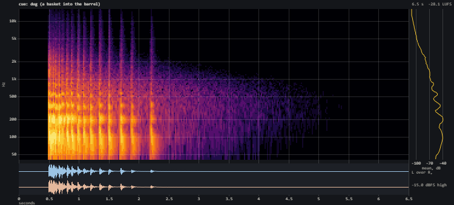

The potato barrel is cedar staves and ash hoops, 48 cm across and 76 cm
deep, 165 pounds full, and a picker fills it with about four baskets of 30
pounds. Dig day's cue is one basket going in.

| | Reference | Render |
| --- | --- | --- |
| The blow | A 200 g tuber stays in contact about 5 ms (Hertz contact, potato stiffness 3 MPa), so it drives the wood mostly under 250 Hz | Rise 3 to 5 ms as written; a thud falling from 131 to 82 Hz, strongest at 95 Hz |
| Wood | Decay time falls as frequency rises, at a loss factor near 0.02 for a free plate; listeners call it rubber near 0.1 (Klatzky et al. 2000; Giordano and McAdams 2006) | Modes written at 196, 338, 527, 806 Hz dying in 50, 30, 19, 12 ms, a loss factor of 0.032 at each; lines measured at 197, 325 to 345 and 520 to 549 Hz |
| The hollow | Air in the barrel rings at 95 Hz empty, 120, 163, 250 Hz at a quarter, half, three-quarters full | A band rising from 105 to 255 Hz through the run, as written |
| The run | A basket tips in a rush and the last tubers roll to rest | 16 to 19 tubers: a tumble of 0.7 s, then gaps of 151, 154, 198, 183 and 322 ms, the knocks falling from -18 to -32 dB |
| Filling | Later tubers land on tubers | Wood modes fall to under half and shorten by a third as it fills, as written |

The contact time says a real tuber puts almost nothing into the wood above
300 Hz. A laptop speaker plays little under 200 Hz and a phone little under
500. The upper modes are therefore kept, 4 to 16 dB under the lowest, so that
the knock survives on small speakers: this is a choice for legibility, against
the physics. The test dig lays each tuber on a wooden tray, as the screen
shows: thinner wood, higher modes (262 to 1130 Hz), no hollow, one knock for
each tuber in the hill, unhurried: gaps of 213 to 294 ms. The tray has no
reference.

### The warning

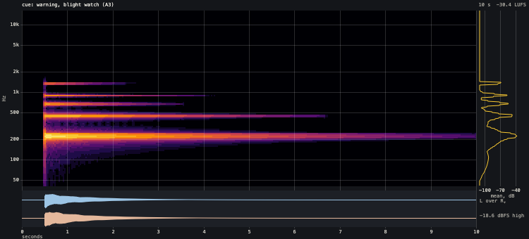

One struck chime for every warning, at a pitch for each kind, lower for worse:
frost C4, blight weather A3, blight seen G3, dry E3, a field lost D3. Soft
mallet: 12 ms rise, the fundamental dying over 3 s. It is the only cue meant to
be noticed over rain, so it carries partials at 2, 3, 4 and 6 times the note:
a phone cannot play 147 Hz but can play 588 and 884, and the ear fills in the
note under them. The blight-weather chime stands 33 dB clear of a steady-rain
bed at its fundamental, and each warning 11 to 20 dB clear of its own bed above
500 Hz. A second warning within 2.5 s is not sounded.

### The closes: year end, farm kept, farm lost

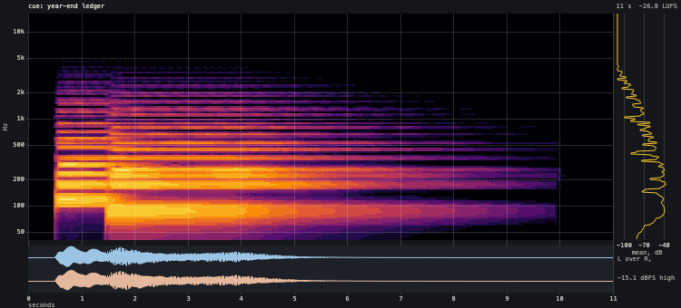
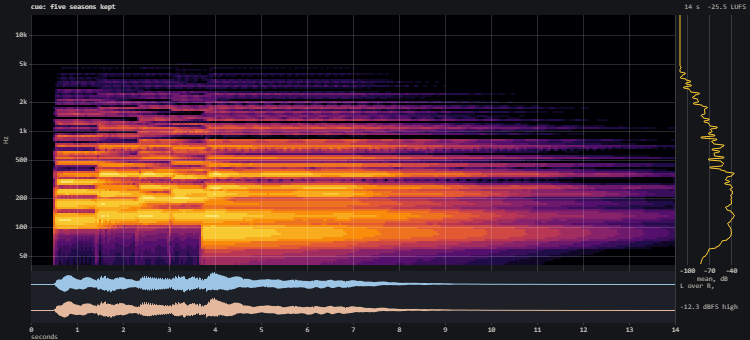
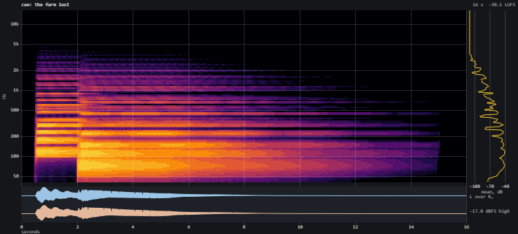

A parlour reed organ: two reeds a few cents apart and a soft octave, low-passed
at 1.5 kHz. All three begin on the same B flat chord.

- **Year end**: IV to I in F, the plain amen. 3.4 s.
- **Farm kept**: IV, I over its fifth, a suspended fourth on V that resolves,
  then home, the top voice climbing D, F, F, E, F to the keynote. 6.2 s. It
  replaces IV, V, I with an added sixth in 4 s. Whether five chords with a
  suspension sound earned and three sounded like a jingle is exactly what
  cannot be measured.
- **Farm lost**: the same opening chord held longer, then down to D with no
  third in it, 2 LU quieter than the year end, left to die over 10 s. No
  chime. Before, the loss had the low warning chime and no close at all.

### Job cues

Planted: two soft pats on earth. Hilled: two sweeps of soil. Sprayed: two
breaths of a nozzle. Watered: two drops. Sold: two coins on a wooden counter.
None has a reference. Each now varies in pitch, spacing and weight from one
time to the next, and at the fastest clock (eight days a second) a job is
heard once a second at most, not once a field.

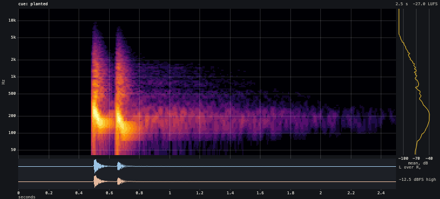
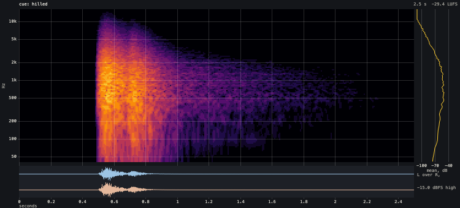
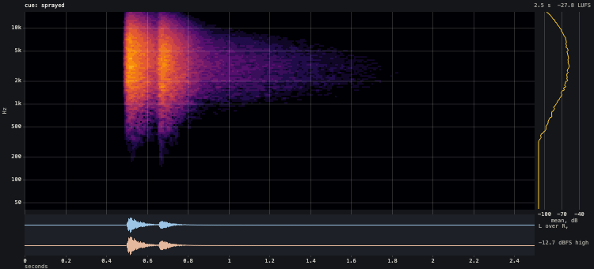
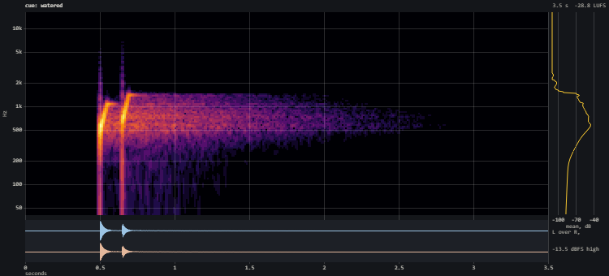
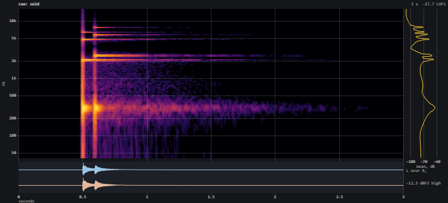

### Spring peepers

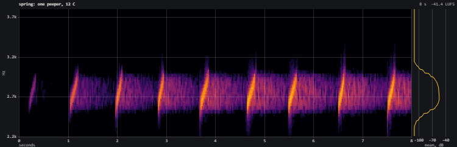

| | Published (Schwartz and Gerhardt 1998; Doherty and Gerhardt 1984) | Render, one frog at 12 C |
| --- | --- | --- |
| Pitch | A peep "averaging about 3 kHz": mean 3011 Hz, 2670 to 3300 between frogs | 2700 to 3300 Hz by frog as written; this one 2590 rising to 2900 |
| Within a note | Rises through it, by about 15% | Rises 14% as written (0.93 to 1.07 of the frog's pitch); measured 12% |
| Length | 90 to 250 ms | 120 to 190 ms as written; measured 107 to 153 ms once the frogs have faded in |
| Rate | 1.27 a second on average, faster when warm: 0.76 + 0.054 a second for each degree (one thesis, read from its index only) | The same line: 1.41 a second at 12 C, each frog 0.75 to 1.35 of that; this one 1.08 |
| When | From mid April, at their height in May; mostly late afternoon and night, most on warm wet nights, "sporadic" by day | Late April to late June; loudest on a mild wet or overcast day, 0.45 of that under a clear sky, silent under 4 C |
| Together | "Sleigh bells"; no two in step | Eight frogs, each at its own pitch and pace |

Still different: a real chorus is hundreds of frogs and can be deafening at
the pond's edge; this one is eight, heard from the fields. The game has no
night, so the frogs call by day more than real ones do: a choice, so that
spring has its sound at all.

### Canada geese

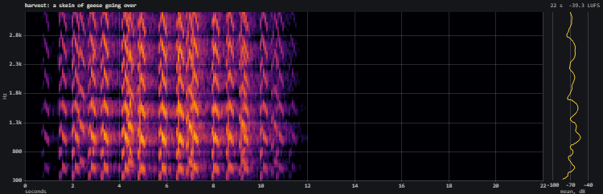

| | Published (Whitford 1998; Whitford and Streng; Collias and Jahn 1959, at second hand) | Render |
| --- | --- | --- |
| Pitch | A voice of 500 to 850 Hz; an alert call from 450 Hz with a first harmonic to 1450 | Ganders 500 to 650 Hz, geese 720 to 850 Hz as written; strongest lines measured between 990 and 1070 Hz and at 1250 and 1530 Hz, the second and third harmonics of those voices, where the first band lets them through |
| The honk | Two parts, "her-onk", with an abrupt break upward between them; 0.3 to 0.64 s | A first part at 0.72 of the pitch for 0.11 s, a jump to it, and a sag of about a tenth to the end; 0.36 s |
| The female | Shorter and higher, 0.10 to 0.13 s | The second part alone, 0.13 s |
| In a flock | No published calling rate was found | The leader about every 0.75 s, the others every 1 to 3 s, three to five birds, 11 to 17 s from first heard to gone |
| When | In the potato country they stage on the dug fields through October and thin out by mid November | Mid September to the freeze, most in October; not in a storm, fog or a gale |

The voice is a buzz of fourteen harmonics through two bands, at 1250 and 2450
Hz. That is a guess at a goose's throat with no measurement behind it, and of
everything here it is the sound least likely to be taken for the real thing.

### American crow

| | Published (Yorzinski and Vehrencamp 2009) | Render |
| --- | --- | --- |
| One caw | 150 to 539 ms | 240 to 320 ms as written |
| Where its energy lies | Strongest at 1292 to 1464 Hz, little above 1550 to 1895 | Bands at 1380 and 1750 Hz, nothing above 2.4 kHz |
| A series | Ordinary calling two to five caws, each within half a second of the last | Two to four, 0.40 to 0.52 s apart; two caws 489 ms apart in the render |
| Harshness | Not measured in what was read | The voice is broken up about 250 times a second and mixed with breath |

### The chickadee's call

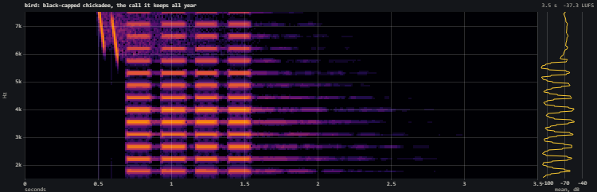

The whistled fee-bee is a spring song. What a chickadee says the rest of the
year is its name, and from August to March that call is the only bird in the
bed.

| | Published (Courter et al. 2020; Grace and Anderson 2014 for a near relative) | Render |
| --- | --- | --- |
| The first notes | Short, high, strongest at 6.7 to 7.0 kHz, falling | Two notes of 45 ms falling from 7.7 and 7.2 kHz by a fourth |
| The dee | Strongest at 3.65 to 3.7 kHz; not a whistle but a stack of evenly spaced overtones, about 450 Hz apart in the Carolina chickadee | A stack 420 to 450 Hz apart through a band at 3.55 to 3.8 kHz; strongest overtones measured between 3.09 and 3.97 kHz |
| How many | 3.7 to 4.3 dees a call on average, widely spread | Three to five by bird, one more or fewer now and then |
| The whole call | 0.99 to 1.24 s | 1.03 s with four dees |
| Length of a dee | Not found for this species; 175 ms in a relative | 170 ms, 62 ms apart |

### A bumblebee

Wingbeat 128 to 210 Hz in queens and 153 to 252 Hz in workers, with energy at
every multiple of it (Gradisek et al. 2017, on European species). The render is
a buzz at 155 to 230 Hz with its harmonics up to 1.5 kHz, passing from one
side to the other in 3 to 5.5 seconds and sagging 3% in pitch as it goes. No
figure was found for how much a passing bee's pitch falls; at a bee's speed
the Doppler shift is about 3%.

### The brook

No reference. A wash of noise around 520 Hz, a narrower band between 1.2 and
2.6 kHz that wanders, and bubbles: short notes sliding upward from 600 Hz to
2.8 kHz, the pitches at which air bubbles from five millimetres in radius
down to a little over one ring under water (Minnaert's resonance: 3.26 kHz
divided by the radius in millimetres). It runs full with the snowmelt in April, falls through the summer to
a sixth of that in August, and rises a little with the fall rains.

### Frost and dry leaves

Trees crack in deep cold "like muffled to loud rifle shots" (Purdue
Extension), at -20 F and below for thick-barked trees. The render is one
report from up the ridge every 18 to 52 seconds in the three coldest months: a
burst around 1 kHz dying in 20 ms, a thump under it, and the hill giving it
back through the reverb. Dry leaves are runs of three to eight ticks between
3.3 and 5.5 kHz, thicker in the gusts, from late September until they are
under snow. Neither was matched to a measurement.

### Felling: the axe, the crosscut saw, the tree

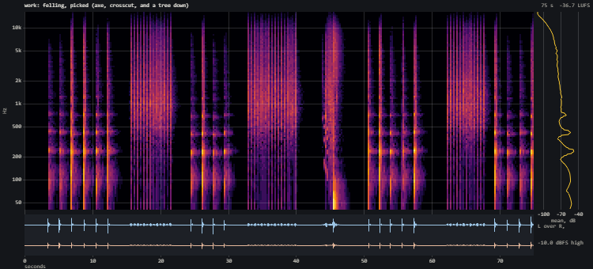

| | Published | Render |
| --- | --- | --- |
| Axe | "The optimum working rhythm with a hammer or an axe is about 25 to 35 strokes per minute" (Glaser, Unasylva) | A blow every 1.7 s (35 a minute), four to six to a bout |
| Crosscut saw | No rate was found for a two-man saw; a one-man bow saw makes 60 to 65 double strokes a minute (FAO). A saw in tune "sings"; out of tune it catches and chatters (USFS) | A stroke each way every 0.49 s (61 double strokes a minute), the pull softer and lower than the push; the rasp is noise around 1 kHz, grained 50 times a second at the middle of the stroke, where a cutter spacing of 25 to 38 mm and a stroke of a metre in 0.4 s would pass 65 to 100 teeth a second |
| The fall | No reference | Seven cracks of the hinge 0.2 s apart closing to 0.03, a rush of air falling from 2.2 kHz to 700 Hz over a second, the ground at 1.55 s (a thump falling from 95 to 48 Hz), a dozen branches breaking over the next second |

An axe blow is a bite of noise at 2.6 kHz, the trunk's answer (four modes from
232 to 1180 Hz, dying at a constant number of cycles like the barrel's wood)
and the blow coming back off the standing timber a quarter of a second later.
The woods give an echo; no figure for it was found.

### Building: nails, the hand saw, boards

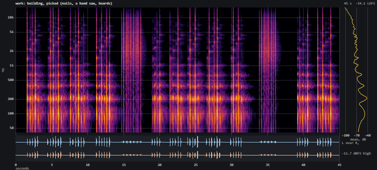

| | Published | Render |
| --- | --- | --- |
| Blows to a nail | Two to three for a framing carpenter with a heavy hammer | Four to six: these are farm hands |
| Rate | 25 to 35 a minute as a day's rhythm (Glaser) | A blow every 0.36 s within a nail, then a pause: about 60 a minute while nailing |
| Pitch | Everyone knows each blow sounds higher than the last; no measurement was found. The free shank of a nail is a clamped rod, whose pitch goes as one over its length squared | The nail's ring climbs from 1.4 to 4.2 kHz through the blows as written, and more of each blow reaches the board; the measurement does not separate the ring from the board, whose modes at 200 and 363 Hz are the strongest lines; the last nail's four blows come 284, 309 and 240 ms apart and grow by 5 dB |
| Hand saw | Seven or eight points to the inch "most in demand" for crosscutting (Disston 1952); no stroke rate was found | Push 0.24 s and pull 0.18 s, the pull much the quieter; rasp around 2.3 kHz grained 400 times a second, as seven teeth to the inch would be at a push of a foot and a half in a quarter second |

### The brush fire

A surface fire's sound spans the whole range with a peak near 220 Hz (Zhang et
al. 2019); no figure was found for how often a fire crackles. The render is a
roar under 420 Hz that breathes every second or two, sparks at about fourteen
a second, most of them faint, and a knot letting go every few seconds.

### The truck

A farm truck of the late 1940s had a straight six idling at 450 to 500 turns a
minute and making its power at 3300 (enthusiast sources, not a manual). A six
fires three times a turn: 25 Hz at idle. The render is the tractor's engine
with six cylinders, a muffler (its exhaust falls away above 170 Hz, not 210)
and smoother running (the half orders 20 dB under the firing, not 11), hauling
at 1700 turns: firing at 85 Hz, measured at 85.8 Hz with its second harmonic at 170.6. No truck was
measured.

### The knock at the door, and the reward

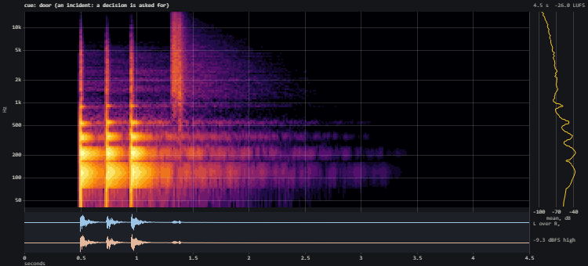
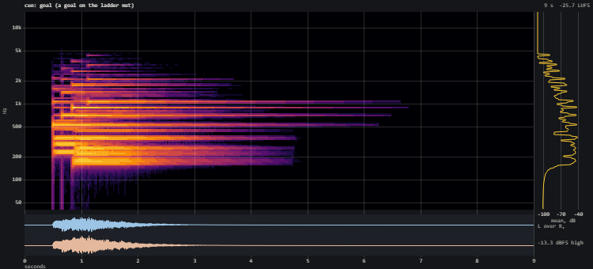

People knock at 4 to 5 knocks a second (Houel et al. 2020, on a fibreboard
door). The knock here is three at 4.3 a second, the last the hardest, on a
panel with modes from 118 to 890 Hz: a door is bigger and deader than a
barrel. It is the one cue that means "this needs an answer", and it is used
for nothing else.

A goal met is the only music in the game outside the three closes, and it is
made of them: the year-end amen (IV to I in F on the parlour organ) in a third
of a second and a second, under four struck bars climbing the chord of F from
C5 to C6. It says "the year will close like this" each time something on the
ladder is reached. Whether that is a reward or a jingle is the first question
on the listening sheet.

### The rest of the farmstead

None of these has a reference; each is built from the same few materials as
the cues that were there before, so that they belong together.

- **Wood**: steps on the porch (hired: up, after the gate latch; gone: down,
  and the door pulled to), boards dropped on the stack (a building begun), the
  last nail and the hammer set down (a building up), logs rolled onto the
  mill's truck, a stump torn out.
- **Iron**: the gate's latch, the anvil's ring for a level gained (a tap and a
  ring a fourth above it), the porch triangle for the people (struck once or
  twice, with the overtones of a free bar at 2.76 and 5.4 times the note,
  which is what says metal and not a chime), a rod letting go in the tractor,
  the ratchet before it starts again, the scale's beam tapping its stop.
- **Stone and clay**: rocks on the stone boat, tile laid end to end and water
  finding it.
- **Paper**: a steel nib (hiss around 5.4 kHz, catching on the grain 38 times
  a second), a rubber stamp, a ticket torn off the pad.

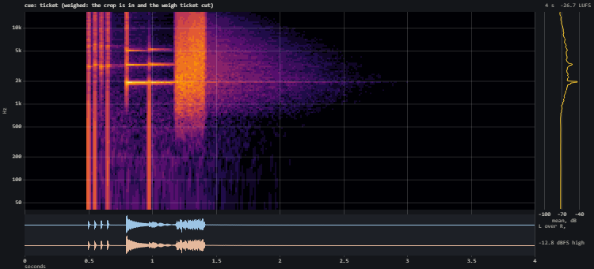
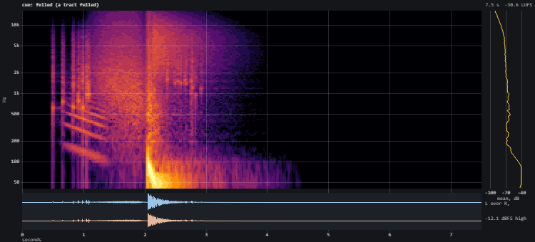
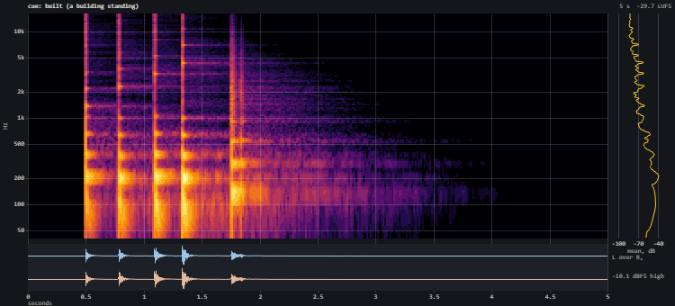
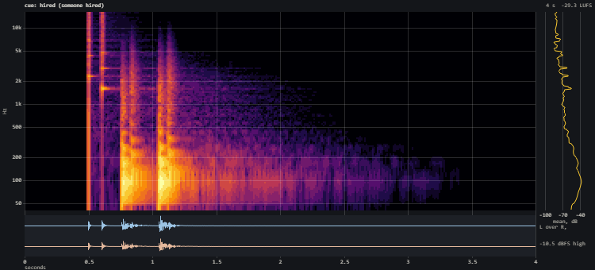
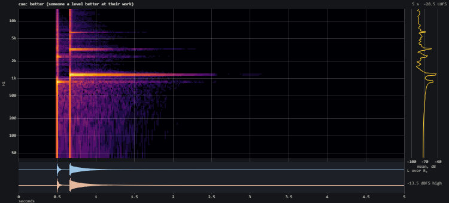
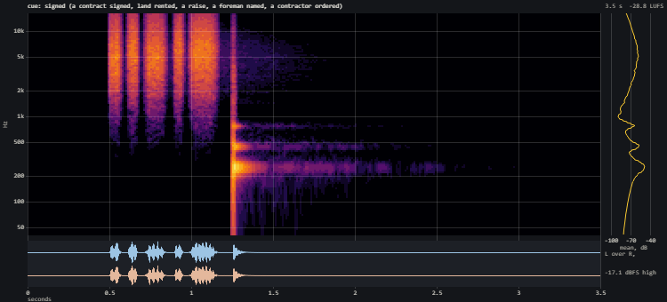

### Picks

A field: one step onto worked ground. A tract: a twig underfoot. A yard: the
gate's hinge and latch, the Dufour gate a third lower. A person: two taps of a
tool handle, the second a third higher, as if asking; the pair sits at one of
six pitches by who the person is, so the first six on a farm can be told apart.
They are the quietest cues in the game, about 8 LU under a job cue, because
they are the most frequent.

### The scenes

Each a minute, driven as the game drives the engine: the scene and the work
re-read every 150 ms, timed sounds scheduled 0.4 s ahead, events through the
same director. The first three are the first rebuild's; the last three are the
farmstead's.

A fair June bed with nobody working:

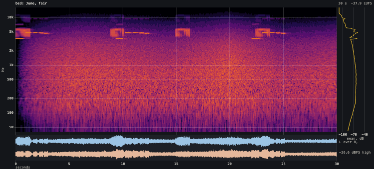

June morning: a white-throated sparrow and a junco, the tractor from 6 to 46 s,
planting at 24 and 41 s, a robin at the end.

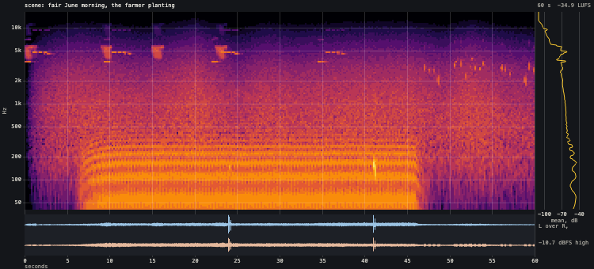

Wet August: rain, the blight-weather chime at 12 s, rain easing at 24 s and the
crickets starting, the tractor at 30 s, the sprayer at 44 s, the blight chime
at 52 s as the tractor stops.

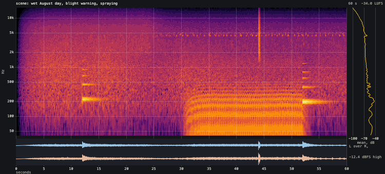

Dig day: wind in gusts, the tractor, a basket into the barrel at 20 and 40 s as
the clock stops, the cellar from 47 s, a sale at 54 s.

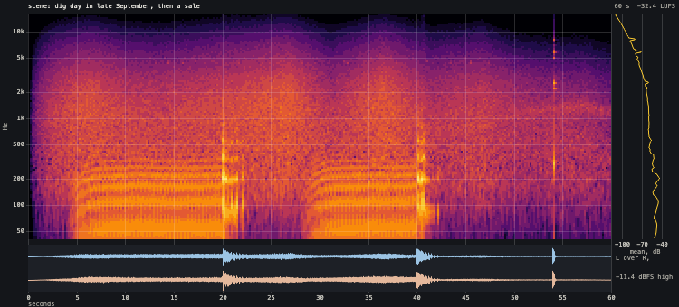

October, a hand felling the woodlot: the axe and saw far off, close from 14 s
when the feller is picked, the last tree at 44 s and the anvil after it, the
tract picked at 50 s and a contractor signed for at 52 s.

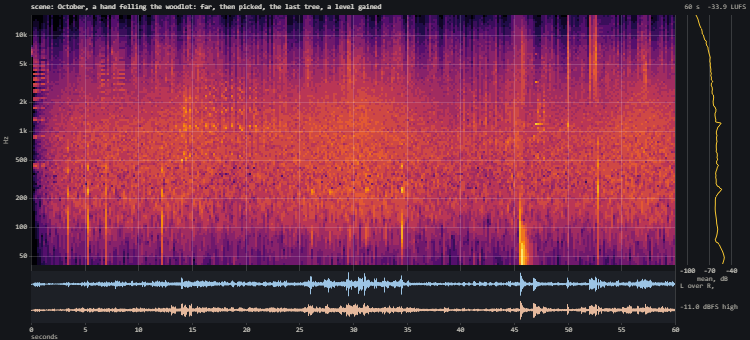

The crop coming in: a basket into the barrel at 12 s, the truck and the barrels
on the ramp far off, close from 22 s with the yard picked, the weigh ticket and
then the goal at 40 s, a knock at 48 s, the door and a sale at 54 s.

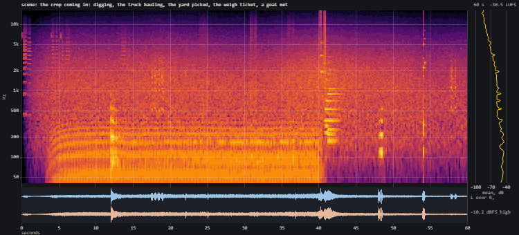

A potato house going up in June: hammer and saw far, close from 10 s, the last
nail and the goal at 36 s, a knock at 46 s, someone hired at 52 s.

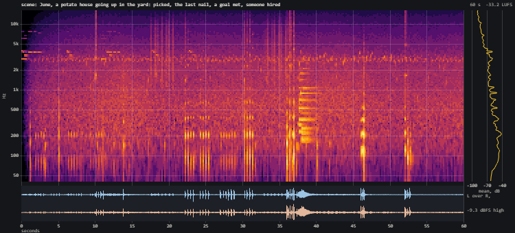

The year in a minute, sixteen seconds each of May, August, October and January:

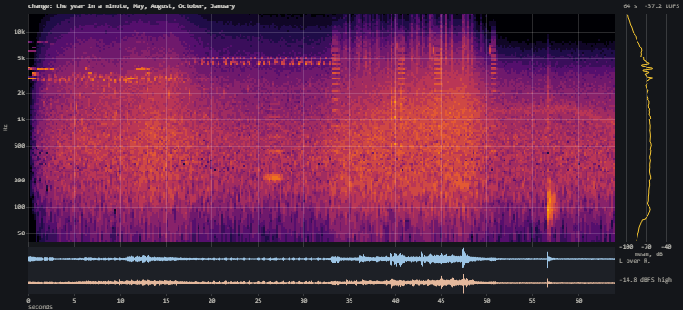

## One soundscape

- **Nothing repeats exactly.** Every random choice comes from the session's
  seeded generator. A bird is an individual with its own song, pitch, place
  and distance, and sings a bout at its species' pace before another takes
  over; two lanes of birds, near and far, overlap. Crickets each have a
  carrier, a pulse count and a pace. Gusts, engine revs, drops and every cue
  draw their timing and pitch fresh.
- **Every change is a fade.** Bed levels move through two gains in series
  toward the square root of the target, so a sound rising from silence starts
  with no slope; gusts and the ridge's pitch glide in equal ratios. Weather crosses over
  in about three seconds. The master fades in over a quarter of a second after
  the first gesture and out in a tenth when sound is switched off or the tab is
  hidden.
- **The limiter is a soft ceiling and nothing else.** The chain ends in a
  fixed gain and a wave-shaping ceiling: unity up to 0.7 of full scale, bending
  to 0.97 and never past it. There was a compressor before it. The
  three-engine check showed that Firefox's let the first tenth of a second of
  any sound that followed quiet through 3 to 5 dB low, so the planted cue
  measured -30.6 LUFS there against -26.0 in Chromium and WebKit, alone or
  four seconds into a render. Without it the three engines agree on every cue
  to 0.2 LU. At the default volume the chain is a plain gain of 5.8 dB: it
  changes no peak in any render, and the highest true peak anywhere is
  -7.4 dBTP. With the slider at its top, a minute of ordinary play peaks at
  0.67 to 0.80 of full scale, at or just over the knee; every cue of the year
  inside 40 seconds reaches 0.96, about 2 dB into the ceiling; everything at
  once sits on it at 0.97.
- **Cost.** The first rebuild's continuous voices run whatever the weather;
  the farmstead's (the brook, the frogs, the truck, the fire, the leaves) are
  built the first time they are wanted, so a farm that never reaches October
  never pays for geese. Anything made of many small sounds (rain's far patter,
  bubbles, sparks, dry leaves) is written once into a few seconds of buffer and
  played round at wandering speeds; a node for each cost ten times as much to
  render. The figure for a gale is under "The instruments".

## The farmstead rounds

What was done after the first rebuild, in the order it was done, by an agent
that could not hear and had one loaded Windows box to render on.

- **Round 9, written.** Cues for every event of the farmstead; the single
  blows they are made of (an axe, a saw stroke, a stone, a hammer, a board);
  work voices made of the same blows in the bouts and rests of a person
  working; picks; the seasons' voices and a calendar for them; a director with
  a list of cues, least gaps, and a line for the longer ones.
- **Round 10, read.** A second agent read the Web Audio code for anything that
  would throw or misbehave before a render was spent on it. It found no
  exception and six defects, all fixed: every frost struck the wrong note (the
  simulation marks frost as bad news, and bad news fell through to the blight
  chime); geese, crows and bees kept a wait drawn while the season was barely
  begun, so an autumn got one skein; taking a field out of the selection
  sounded a pick; honks could pile up after a stall; a cue dropped from the
  line still used up its gap, and a dropped reward was lost; the truck was
  heard for a tractor's haul.
- **Round 11, cost.** The first renders ran at about real time where the old
  ones ran five times faster. Dry leaves, the brook's bubbles and the fire's
  sparks had been a node for each tick; they became looped textures.
- **Rounds 12 on, levels.** Each render measured, each level moved to its place
  in the plan, the cues compared with each other and the seasons with each
  other. The tables in this file are the last of these.

## What is still not known

- Whether any of it is pleasant, or tiring over an evening.
- Whether the birds, the frogs, the geese, the tractor, the axe and the barrel
  are recognised for what they are. Matching pitch, rhythm and spectrum is
  necessary for that and may not be enough: timbre lives in detail these
  tables do not hold. The geese and the crow are the least certain: a voice is
  the hardest thing here to make from oscillators and filters.
- Whether the reward for a goal lands, whether the cadence for keeping the farm
  does, and whether the loss is sober or merely dull.
- Whether three knocks read as a door, and a door as "someone wants an
  answer".
- The balance on real loudspeakers. Masking was estimated band by band from
  levels, not with a model of hearing, and small-speaker behaviour was
  inferred from published roll-offs, not measured on a device.
- Whether the seasons are told apart by a person. The print distance between
  two beds is a number made for this check; it says the beds differ in where
  their energy lies and how it moves, not that an ear hears "October".
- Live behaviour on a phone. The live engine is exercised in headless
  browsers (autoplay gate, volume, mute, hidden tab, picks, felling with the
  feller picked, reduced motion on); iOS Safari's own rules were not, nor the
  cost on a slow phone.
- Soft thumps. The click test finds true breaks in the waveform; a step
  smeared over a millisecond passes it unless it is large (see "What was
  done"). Nothing in the code makes one, but the test would not have said.
- Chromium ends a `setTargetAtTime` fade about 6.5 time constants in, a step
  some 56 dB under where the fade began. In the longest cue that is under
  -89 dBFS.
- The offline renders and the live game share every voice, the event
  director and the frame loop's timing, but the live game was only checked
  for level and errors, not recorded and measured. What the offline renders
  cannot show at all is the moment-to-moment fit with the picture: whether the
  axe is heard when a figure swings one. The work voices follow who did what
  that day and what the player has picked; they are not locked to the
  animation, which was being written at the same time by another hand.

## What only a listener can judge

In the order it matters:

1. **The reward.** `cue-goal`: is it a sound you would want to hear again, at
   the eighth goal as at the first? Too sweet, too long, too much like a phone?
2. **The knock.** `cue-door`: a door, and somebody at it? Or a drum?
3. **The seasons.** `change-seasons` with your eyes shut: name the four. Then
   the four `season-` files. Are the peepers frogs or an alarm? Are the geese
   geese? Is winter empty in a good way?
4. **Work.** The `work-` files: an axe in green wood and a crosscut saw, or
   clicks and hiss? Does the tree come down? Is the fire a fire? Do the nails
   climb in pitch as they go in?
5. **Wood, iron, stone, paper.** `change-farmstead`, every farmstead cue in the
   order of a year: do they belong to one game and to the one that was there
   before (`change-cues`)? Can you tell hired from left, the pen from the
   sprayer, the anvil from the coins?
6. **Fatigue.** Play the game for an hour with the picks, the order knock and
   the work voices going. What do you want to turn off?
7. **Fit.** In the game: does what you hear when you pick a person match what
   they are doing on the screen?

## Listening sheet

Ten minutes, with headphones. Make the WAVs with the first command at the top
of this file; each is `<number>-<name>.wav`, and the names below are the part
after the number. They are at the game's default volume, so they are quiet:
set the system volume where speech from a video is comfortable and leave it
there.

| File | Seconds | Listen for |
| --- | ---: | --- |
| `change-seasons` | 64 | Start here, eyes shut. Sixteen seconds each of late May (birdsong, the brook, peepers behind it), early August (crickets, a bumblebee going by, leaves), early October (wind in dry leaves, a crow, geese going over if the luck of this render has them) and January (a thin cold wind, a tree cracking, a chickadee). Could you name each? Do the changes between them bump? |
| `cue-goal` | 9 | The reward. Organ, then four struck bars climbing. Want it again? |
| `cue-door` | 5 | Three knocks. A door? |
| `change-farmstead` | 68 | Every farmstead cue, about two seconds apart: hired (latch, steps), a contract signed (pen), land bought (pen, stamp), a building begun (boards), then picks of a person, a yard, a tract and a field and the order knock, rocks, brush, a level gained (anvil), someone worn out (iron bar), a breakdown, the repair, a knock at the door, the matter closed (latch), a building up (four rising blows), a goal met, someone hurt (the bar twice), the weigh ticket (scale beam, paper tearing), a tract felled (the tree), stumps out, tile drains, logs sold, the mortgage paid, someone leaving (steps, the door). Which could you not place? |
| `change-pileup` | 20 | Everything on one day: does anything trample anything? The order should be the weigh ticket, the knock, the tree, the building, the anvil, and last the goal. |
| `scene-clearing` | 60 | October. An axe and saw far off in the woodlot; at 14 s the feller is picked and it comes close; the last tree at 44 s, then the anvil; a tract picked and a contractor signed for. Is far too quiet to notice, or near too loud to leave on? |
| `scene-haul` | 60 | Dig day: the tractor, a basket into the barrel, the truck far then near with barrels rolling down the ramp, the weigh ticket and the goal at 40 s, a knock at 48 s, a sale. |
| `scene-raising` | 60 | June: hammering and sawing far, then near; the last nail and a goal at 36 s; a knock, someone hired. |
| `work-fell`, `work-build`, `work-brush`, `work-rocks`, `work-barrels` | 15 each | Each kind of work alone and close. Wood, or clicks? |
| `season-spring`, `season-harvest` | 30 each | The two richest beds at length: anything that nags? |
| `geese`, `crow`, `peepers`, `bird-dee`, `bee`, `frost` | 40 in all | The new voices alone. The geese and the crow are the least certain. |
| `change-cues` | 44 | The cues that were there before, for comparison: do the new ones belong with them? |
| `scene-june`, `scene-august`, `scene-dig` | as time allows | The first rebuild's scenes; they should sound as they did, with a brook under June. |
| `stress` | 9 | Everything at once. It should be ugly and must not crackle. |

## Sources

Read first hand by the agent that wrote this file: Bolin 2009 (pages 607 to
611), the TractorData page for the Farmall H, the SINA page for the fall field
cricket, and Klatzky et al. 2000 (page 4). Everything else was read by three
research agents, which opened the pages and returned figures with quotations;
their reading is what is cited. Where a figure is their own arithmetic or
their own reading of a recording it is said so above.

Birds
- Borror and Gunn 1965, Variation in White-throated Sparrow songs, Auk 82:26. https://sora.unm.edu/sites/default/files/journals/auk/v082n01/p0026-p0047.pdf
- Weary and Weisman 1992, Condor 94:1013. https://sora.unm.edu/sites/default/files/journals/condor/v094n04/p1013-p1016.pdf
- Grunst et al. 2018, Ecology and Evolution 8:1369. https://pmc.ncbi.nlm.nih.gov/articles/PMC5773301/
- Riede and Suthers 2009. https://pmc.ncbi.nlm.nih.gov/articles/PMC2826496/
- Otter et al. 2020, Current Biology; McKenna 2017 (thesis, UNBC), for where the triplet ending still holds. https://www.unbc.ca/sites/default/files/sections/ken-otter/mckenna-finalthesis2017.pdf
- Weisman, Ratcliffe, Johnsrude and Hurly 1990, Condor 92:118. https://sora.unm.edu/sites/default/files/journals/condor/v092n01/p0118-p0124.pdf
- Ficken, Ficken and Witkin 1978, Auk 95:34. https://sora.unm.edu/sites/default/files/journals/auk/v095n01/p0034-p0048.pdf
- Horn et al. 1992, Auk 109:847. https://sora.unm.edu/sites/default/files/journals/auk/v109n04/p0847-p0852.pdf
- Johnson 2006, Wilson Journal of Ornithology 118:341. https://zenodo.org/records/16564679
- Bent 1949, the robin account. https://www.birdsbybent.com/ch31-40/robin.html
- Titus 1998, Auk 115:386. https://sora.unm.edu/sites/default/files/journals/auk/v115n02/p0386-p0393.pdf
- Konishi 1964, Condor 66:423. https://sora.unm.edu/sites/default/files/journals/condor/v066n05/p0423-p0436.pdf
- Cornell Lab, All About Birds, sounds pages for each species. https://www.allaboutbirds.org/guide/White-throated_Sparrow/sounds

Crickets
- Singing Insects of North America, *Gryllus pennsylvanicus*, with a recording at 24.4 C. https://orthsoc.org/sina/489a.htm
- Bertram et al. 2013, PLoS ONE 8:e69247. https://pdfs.semanticscholar.org/6947/4df962ec00d302af14f21cf3fcbd52be63de.pdf
- Harrison et al. 2013, PLoS ONE 8:e60356. https://journals.plos.org/plosone/article?id=10.1371/journal.pone.0060356
- Alexander 1957, the field crickets of the eastern United States. https://orthsoc.org/sina/g464la57.pdf
- Weissman and Gray 2019. https://orthsoc.org/sina/s464wg-gpennsylvanicus.pdf
- Dolbear 1897, The cricket as a thermometer, American Naturalist 31:970; Walker 1962, for which cricket it describes. https://orthsoc.org/sina/s576lw62.pdf
- Martin, Gray and Cade 2000, and Pires and Hoy 1992 (abstract), for temperature. https://www.csun.edu/~dgray/pdfs/Martinetal2000CJZtemp.pdf

Rain and wind
- Metcalf et al. 2020, hardRain (preprint). https://eprints.lancs.ac.uk/138438/1/Metcalf_et_al._hardRain_preprint.pdf
- Brown et al. 2018. https://arxiv.org/html/1804.05502v1
- Ferroudj et al. 2014. https://eprints.qut.edu.au/76561/
- Phillips and Jordan, The annoying dripping tap, Physics Today. https://physicstoday.aip.org/quick-study/the-annoying-dripping-tap
- Bolin 2009, Prediction method for wind-induced vegetation noise, Acta Acustica 95:607. https://dael.euracoustics.org/bin/EAA/aaua_dl?document_id=64838
- Fegeant 2002, KTH report 2002:12. https://www.osti.gov/etdeweb/servlets/purl/20354687
- Boersma 1997, JASA 101:2104 (abstract). https://pubs.aip.org/asa/jasa/article-abstract/101/4/2104/558502/

Tractor and barrel
- Nebraska Tractor Test 333, Farmall H, 1939. https://digitalcommons.unl.edu/tractormuseumlit/102/
- TractorData, Farmall H engine. https://www.tractordata.com/farm-tractors/000/2/9/290-farmall-h-engine.html
- Guyer, Introduction to sound level data for mechanical and electrical equipment (unmuffled exhaust, Table 18). https://www.cedengineering.com/userfiles/Intro%20to%20Sound%20Level%20Data%20for%20Mech%20&%20Elec%20Equip.pdf
- Maine Memory Network: tractor delivery, Presque Isle, about 1950 (item 22415); potato barrels (items 12957, 12952); picking (item 19015). https://www.mainememory.net/record/22415
- Celik et al. 2019, potato stiffness. https://eprints.lancs.ac.uk/id/eprint/133807/1/J_Food_Proc_Eng_Apr2019_Potato_Collision_Rev_012.pdf
- Klatzky, Pai and Krotkov 2000, Perception of material from contact sounds. https://www.cs.ubc.ca/labs/lci/papers/docs2000/pai-KlaPai00.pdf
- Giordano and McAdams 2006, JASA 119:1171. https://www.mcgill.ca/mpcl/files/mpcl/blg_smc_2006_jasa.pdf
- Aramaki et al. 2011, IEEE TASLP 19:301.

Hearing and loudness
- ITU-R BS.1770; EBU R 128 and Tech 3343. https://tech.ebu.ch/docs/r/r128.pdf
- Sony ASWG-R001. https://gameaudiopodcast.com/ASWG-R001.pdf
- Torcoli et al. 2019, JAES, on speech over background.
- ISO 7731 (audibility of a signal in noise); ISO 226:2003; DIN 45692.
- Guttman and Julesz 1963, JASA 35:610; Kaernbach 2004, The memory of noise, Experimental Psychology 51:240.
- Notebookcheck speaker measurements, for where laptops and phones stop playing.
Frogs, geese, crows, bees (read by a research agent for the farmstead rounds, which opened the pages and returned figures with quotations; where it could reach only an abstract or an index it said so, and that is repeated above)
- Schwartz and Gerhardt 1998, Animal Behaviour 56:55, the spring peeper's call. https://webpage.pace.edu/jschwartz2/schwartz%20et%20al%201998.pdf
- Doherty and Gerhardt 1984, Animal Behaviour (abstract only), call length. https://www.sciencedirect.com/science/article/abs/pii/S0003347284801657
- A thesis indexed at Indiana State University for the peeper's call rate against temperature (indexed text only; the PDF could not be opened). https://scholars.indianastate.edu/cgi/viewcontent.cgi?article=1140&context=etds
- Wild Adirondacks, spring peeper, for when they call. https://wildadirondacks.org/adirondack-amphibians-spring-peeper-pseudacris-crucifer.html
- Whitford 1998 and Collias and Jahn 1959 on Canada goose calls, as quoted at https://pages.vassar.edu/sensoryecology/canada-goose-vocalizations/ ; Whitford and Streng, alarm and alert calls. https://bird-x.com/wp-content/uploads/Efficacy-Recorded-Alarm-Alert-Calls-Canada-Goose-Dispersal.pdf
- Yorzinski and Vehrencamp 2009, Condor 111:159, the structure of crow caws. https://yorzinskilab.org/wp-content/uploads/2021/02/yorzinskivehrencamp_2009.pdf
- Courter et al. 2020, PLoS ONE e0241035, chick-a-dee calls. https://www.ebi.ac.uk/europepmc/webservices/rest/PMC7595340/fullTextXML
- Grace and Anderson 2014, for the spacing of a D note's overtones (Carolina chickadee). http://rindyanderson.weebly.com/uploads/1/4/5/0/14503946/grace__anderson_2014_chickadees_in_noise.pdf
- Gradisek et al. 2017, Bioacoustics, bumblebee flight buzz. https://dis.ijs.si/mitjal/documents/Gradisek-Predicting_species_identity_of_bumblebees_through_analysis_of_flight_buzzing_sounds-Bioacoustics-16.pdf

Work
- Glaser, Unasylva 8(4), the working rhythm of an axe or a hammer. https://www.fao.org/4/x5373e/x5373e04.htm
- FAO Forestry Paper 36, bow saw stroke rates. https://www.fao.org/4/an777e/an777e00.pdf
- Disston Saw, Tool and File Manual 1952, points to the inch. https://archive.org/stream/DisstonSawToolFileManual1952/Disston%20Saw%20Tool%20File%20Manual%201952_djvu.txt
- US Forest Service, Saws That Sing, 2004. https://www.bcha.org/wp-content/uploads/2024/09/Saws-That-Sing.pdf
- Zhang et al. 2019, Sensors 19:5093, the sound of surface and crown fires. https://pdfs.semanticscholar.org/ee1a/caca6ce0bbde6b1e8f09c8ee3e08436cfaef.pdf
- Purdue Extension, frost cracks. https://purdue.edu/fnr/extension/snap-crackle-and-pop-walking-in-a-winter-wonderland
- Houel et al., SMC 2020, how fast people knock. https://zenodo.org/records/3898922
- Engine figures for a straight-six farm truck of the late 1940s (enthusiast pages, not factory manuals). https://www.conceptcarz.com/s11566/chevrolet-3100.aspx
